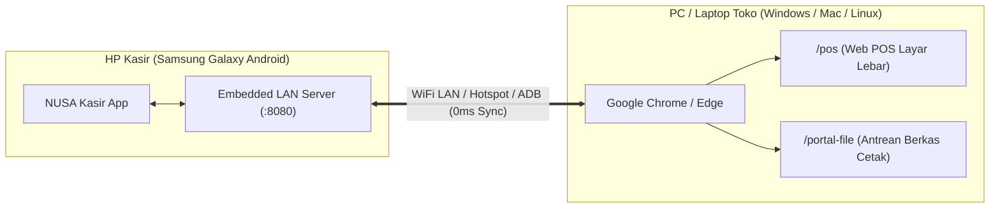

# NUSA PC Connect Studio (Sambungkan ke Komputer & Portal File)

Skill khusus bagi **Agent Editor Konten & Content Studio** untuk memproduksi video demonstrasi, tutorial, dan iklan komersial berkonversi tinggi seputar fitur **"Sambungkan ke Komputer" (LAN Web POS & Portal File)** NUSA Kasir.

Fitur ini adalah **magnet penjualan (killer feature)** terbesar untuk UMKM, terutama pemilik toko fotocopy, percetakan, minimarket, kafe/resto, dan bengkel yang ingin kasir layar lebar di monitor PC tanpa perlu beli software mahal atau sewa bulanan.

---

## 1. Arsitektur Teknis "Sambungkan ke Komputer"

NUSA Kasir menjalankan *Embedded Local HTTP & WebSocket Server* langsung di dalam HP Android (Port `8080` / `8081`). Komputer/laptop di toko **TIDAK PERLU INSTALL SOFTWARE APAPUN** dan **TIDAK PERLU EMULATOR**.



### Endpoint & Rute Bawaan:
1. **`/pos`** (atau `/`): Terminal Kasir Layar Monitor Desktop (keyboard & mouse ready, grid produk berfoto, keranjang belanja, checkout cepat).
2. **`/portal-file`** (atau `/files`): Portal Antrean File Operator Percetakan/Fotocopy (operator bisa langsung klik unduh PDF/Word/Foto pelanggan tanpa flashdisk).
3. **`/cetak`** (atau `/kirim-file`): Form upload mandiri bagi pelanggan dari HP mereka ke antrean toko.

---

## 2. Tiga Arketipe Naskah Komersial (High Conversion)

### 📌 Arketipe A: Fotocopy Hero (Solusi Anti-Colok Flashdisk)
- **Target Audiens**: Pemilik Usaha Fotocopy, Digital Printing, dan Percetakan.
- **Durasi**: 30 – 40 Detik (9:16 Vertical).
- **Core Hook**: "Buka fotocopy kok masih ribet colok flashdisk pelanggan? Awas laptop toko kena virus!"
- **Tabel Beat & Visual Direction**:

| Detik | Narasi Suara (Charon 1.0x) | Visual Utama | Aksi Layar & SFX |
|:---|:---|:---|:---|
| `00 - 04` | "Buka fotocopy kok masih ribet colok-cabut flashdisk pelanggan? Laptop toko bisa kena virus lho!" | B-Roll close-up tangan colok flashdisk lusuh ke laptop toko / wajah pemilik stres. | `shock_hit.wav`, zoom punch 1.3x. |
| `04 - 10` | "Pakai NUSA Kasir Fotocopy. Cukup klik menu **'Sambungkan ke Komputer'** dari HP!" | Layar HP Z Flip 3 membuka menu pengaturan $\rightarrow$ ketuk 'Hubungkan Komputer'. | `card_pop.wav`, haptic tick. |
| `10 - 18` | "Buka Google Chrome di PC tokomu. File kiriman pelanggan langsung muncul otomatis di monitor!" | Layar monitor PC membuka `localhost:8080/portal-file`, antrean 4 berkas skripsi & brosur muncul. | `swish.wav`, audio ding `ding_notification.wav`. |
| `18 - 26` | "Tinggal klik **'Unduh ke PC'**, dokumen langsung kebuka dan siap diprint. Zero kabel, zero flashdisk!" | Cursor PC mengklik tombol biru `📥 Unduh ke PC` $\rightarrow$ file PDF terunduh instan & preview terbuka. | `click.wav`, highlight sweep kuning `#FFE04A`. |
| `26 - 32` | "Biaya fotocopy, print warna, dan jilid skripsi otomatis terhitung di kasir. Praktis banget kan?" | Split-screen: monitor PC menampilkan total harga, HP kasir mencetak struk thermal. | `cash_register.wav`, struk terdorong keluar. |
| `32 - 35` | "Sekali beli aktif selamanya tanpa biaya bulanan. Cek keranjang sekarang!" | Layar HP menampilkan logo NUSA Fotocopy + CTA tombol panah. | Outro abrupt silence, link toko. |

---

### 📌 Arketipe B: Kasir Layar Lebar 2-Screen (HP + Monitor PC)
- **Target Audiens**: Toko Kelontong, Minimarket, Kafe/Restoran, Bengkel, Apotek.
- **Durasi**: 30 – 45 Detik (9:16 Vertical).
- **Core Hook**: "Mau punya komputer kasir layar lebar tapi gamau bayar sewa jutaan rupiah tiap bulan?"
- **Tabel Beat & Visual Direction**:

| Detik | Narasi Suara (Charon 1.0x) | Visual Utama | Aksi Layar & SFX |
|:---|:---|:---|:---|
| `00 - 05` | "Mau punya komputer kasir layar lebar di toko, tapi malas sewa software mahal jutaan rupiah?" | Visual PC desktop biasa dengan monitor lebar di meja kasir. | `didone_shock` "MAHAL?". |
| `05 - 12` | "Cukup pakai NUSA Kasir di HP Androidmu. Ada fitur bawaan **Sambungkan ke Komputer**!" | HP Z Flip 3 di depan keyboard PC, user menyalakan toggle WiFi server. | `swish.wav`, status hijau menyala `● Terhubung`. |
| `12 - 20` | "Tinggal buka Google Chrome di PC, monitor tokomu seketika berubah jadi kasir layar penuh!" | Monitor PC membuka `localhost:8080/pos`, grid produk makanan/sembako muncul lengkap dengan foto & harga. | `whoosh.wav`, grid produk reveal. |
| `20 - 28` | "Input transaksi pakai keyboard dan mouse. Data di HP dan komputer sinkron realtime nol detik!" | Kasir klik produk di PC $\rightarrow$ angka di HP langsung berubah detik itu juga. | `click_fast.wav`, sync pulse. |
| `28 - 35` | "Selesai bayar, struk langsung tercetak dari printer. Sekali beli untuk seumur hidup, 0 biaya langganan!" | Printer thermal mengeluarkan struk belanja, cash drawer otomatis melenting terbuka. | `cash_drawer.wav`, `receipt_print.wav`. |

---

### 📌 Arketipe C: Tech Myth-Busting (Bisa di PC? Jangan Pakai Emulator!)
- **Target Audiens**: Calon pembeli yang ragu apakah aplikasi HP bisa dipakai di PC.
- **Durasi**: 40 – 50 Detik (9:16 Vertical).
- **Core Hook**: "Banyak yang nanya: 'Kak NUSA Kasir bisa di PC gak?'. Jawabannya BISA BANGET, dan JANGAN pasang emulator!"
- **Tabel Beat & Visual Direction**:

| Detik | Narasi Suara (Charon 1.0x) | Visual Utama | Aksi Layar & SFX |
|:---|:---|:---|:---|
| `00 - 05` | "Banyak yang nanya ke admin: 'Kak, NUSA Kasir bisa dipasang di PC atau laptop gak?'" | Screenshot chat WhatsApp / Shopee calon pembeli menanyakan PC. | `message_pop.wav`, highlight bubble chat. |
| `05 - 12` | "Jawabannya: BISA BANGET! Dan ingat ya, JANGAN install emulator yang bikin PC lemot!" | Tanda silang merah di atas logo emulator berat $\rightarrow$ centang hijau di atas icon Chrome. | `error_buzz.wav` $\rightarrow$ `success_bell.wav`. |
| `12 - 22` | "Di NUSA Kasir sudah ada fitur **Web POS bawaan**. Cukup buka Google Chrome di komputer tokomu!" | Screen recording browser Chrome mengetik alamat IP $\rightarrow$ langsung masuk terminal kasir. | `keyboard_typing.wav`, smooth zoom in. |
| `22 - 32` | "Tanpa install aplikasi apapun di laptop. Semua data tersimpan aman di HP, bebas biaya bulanan selamanya." | Dual camera angle memperlihatkan HP kasir berdampingan dengan laptop kasir. | `swish.wav`, smooth pan. |

---

## 3. Komposisi Visual & Dual-Screen Layout (9:16)

Dalam video vertikal 9:16 (`1080x1920`), mendemokan 2 layar (HP + Layar PC) membutuhkan tata letak yang proporsional dan tidak bertumpuk:

```
┌──────────────────────────────────────────────┐
│  Kanvas 9:16 (1080 x 1920 px)                │
│                                              │
│  ┌────────────────────────────────────────┐  │
│  │ LAYAR MONITOR PC (Google Chrome)       │  │
│  │ Aspect 16:9 (`960 x 540 px`)           │  │
│  │ [Antrean File / Web POS Layar Lebar]   │  │
│  └────────────────────────────────────────┘  │
│                                              │
│                     ↕ SYNC ARROW ⚡         │
│                                              │
│  ┌────────────────────────────────────────┐  │
│  │ MOCKUP SAMSUNG Z FLIP 3 (HP KASIR)     │  │
│  │ Bodi Vektor HP (`540 x 1140 px`)       │  │
│  │ [Status Server / Cetak Struk]          │  │
│  └────────────────────────────────────────┘  │
│                                              │
│  [ SUBTITLE TIPOGRAFI MURNI (Rule 15) ]      │
└──────────────────────────────────────────────┘
```

### Spesifikasi Layout Baku:
- **Monitor PC Window**: Koordinat `x = 60, y = 140`, resolusi `960 x 540 px`, radius sudut `16px`, drop shadow lembut `0 10px 30px rgba(0,0,0,0.5)`.
- **Samsung Z Flip 3 Frame**: Terletak di bawah window monitor pada `cx = 540, y = 1180`, ukuran frame `540 x 1140 px`.
- **Indikator Sync**: Animasi partikel gelombang WiFi atau petir emerald `#10B981` antara PC dan HP saat transaksi/unduh berkas terjadi.
- **Subtitle Tipografi Murni (Rule 15)**: Bold putih melayang `#FFFFFF` di `y = 1720px`, deep multi-layer shadow, zero box wrapper.

---

## 4. Cara Menjalankan Sandbox & Demo untuk Rekaman

### Mode A: Menggunakan HP Android Fisik / Sandbox APK
1. Sambungkan HP Samsung Z Flip 3 ke PC via kabel USB (ADB aktif).
2. Aktifkan port forwarding ADB:
   ```bash
   adb forward tcp:8080 tcp:8080
   ```
3. Beralih ke varian `nusa-fotocopy` via intent instan:
   ```bash
   adb shell am start -n com.nusa.dev/com.example.nusa_kasir.MainActivity --es variant fotocopy --ez pro true
   ```
4. Buka Google Chrome di PC ke alamat:
   - Antrean Berkas Fotocopy: `http://localhost:8080/portal-file`
   - Terminal Kasir Layar Lebar: `http://localhost:8080/pos`
5. *Auto-Auth Sandbox*: Di versi sandbox, browser langsung otomatis terotorisasi sebagai Owner tanpa perlu scan QR. (Jika diminta PIN pairing, masukkan PIN dev universal: `1234` atau `280303`).

### Mode B: Standalone PC Microserver (Tanpa Perlu HP Tercolok)
Jika sedang mengedit di PC tanpa menghubungkan HP fisik, jalankan script runner yang sudah disediakan:
```bash
python .agents/skills/nusa-pc-connect-studio/scripts/run_pc_portal_sandbox.py
```
Script ini akan:
- Memeriksa koneksi ADB secara otomatis.
- Jika tidak ada HP, langsung menyalakan server lokal mandiri di port `8080`.
- Membuka Chrome secara otomatis ke `http://localhost:8080/portal-file`.
- Menyajikan 4 berkas pesanan fotocopy asli (Skripsi Budi Santoso, Brosur Siti, Surat RW Joko, Ijazah Hendra) yang **bisa langsung diklik 'Unduh ke PC'** dan mengunduh berkas PDF asli ke folder Downloads PC!

---

## 5. File Frontend & Aset Sandbox Terkait

Seluruh kode antarmuka Web POS & Portal File tersimpan rapi dan siap dimodifikasi / di-embed:
- **Portal Antrean File Percetakan**: [portal_file_sandbox.html](file:///c:/Users/ertyui/ZCodeProject/.agents/skills/nusa-pc-connect-studio/assets/portal_file_sandbox.html)
- **Web POS Terminal Kasir Layar Penuh**: [web_pos_sandbox.html](file:///c:/Users/ertyui/ZCodeProject/.agents/skills/nusa-pc-connect-studio/assets/web_pos_sandbox.html)
- **Python Microserver Runner**: [run_pc_portal_sandbox.py](file:///c:/Users/ertyui/ZCodeProject/.agents/skills/nusa-pc-connect-studio/scripts/run_pc_portal_sandbox.py)

---

## 6. Standar Audio & Sound Design
- **Voiceover TTS**: Gemini Native Audio TTS (`gemini-2.5-flash-preview-tts`), suara `Charon` (Maskulin berwibawa, tempo 1.0x native, artikulasi tegas).
- **Transient SFX Timing**:
  - Saat file pelanggan masuk: `ding_notification.wav` (587Hz $\rightarrow$ 880Hz chime).
  - Saat klik tombol 'Unduh ke PC': `click.wav` + `swish.wav`.
  - Saat checkout kasir: `cash_register.wav` / `kaching.wav`.
  - Ducking musik latar: `-7 dB` saat narasi berbicara, `abrupt silence cut` di detik terakhir CTA.
